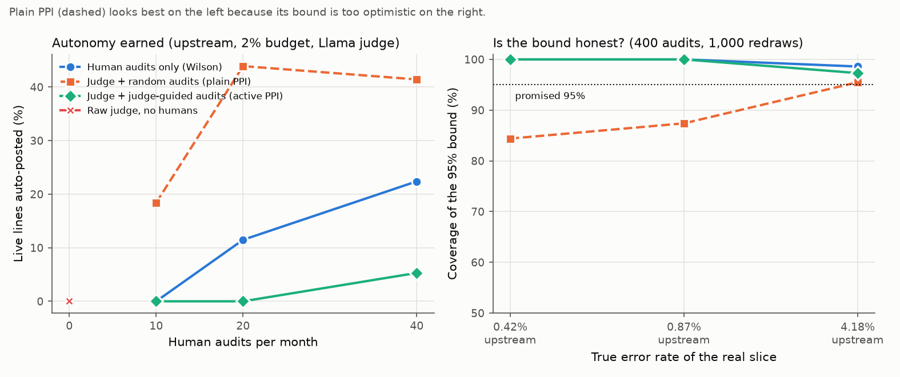
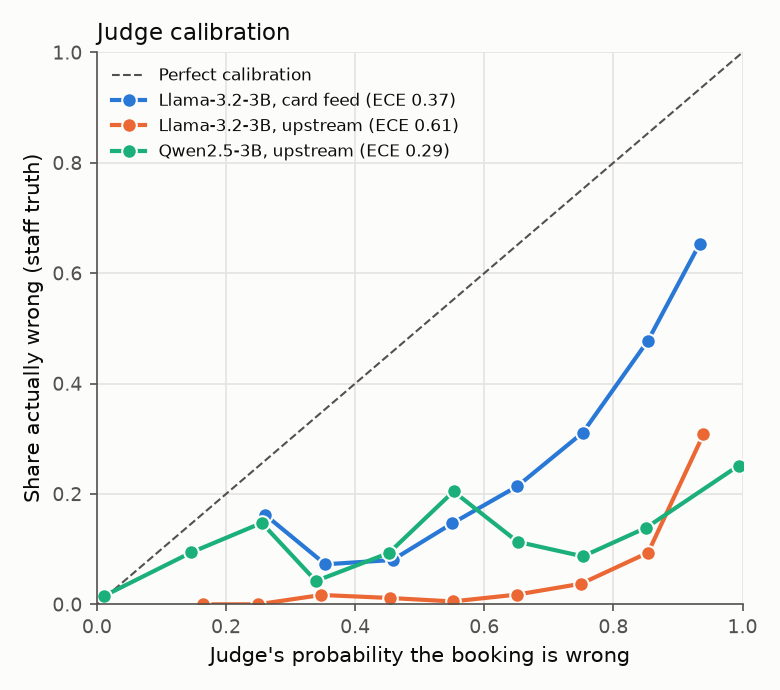
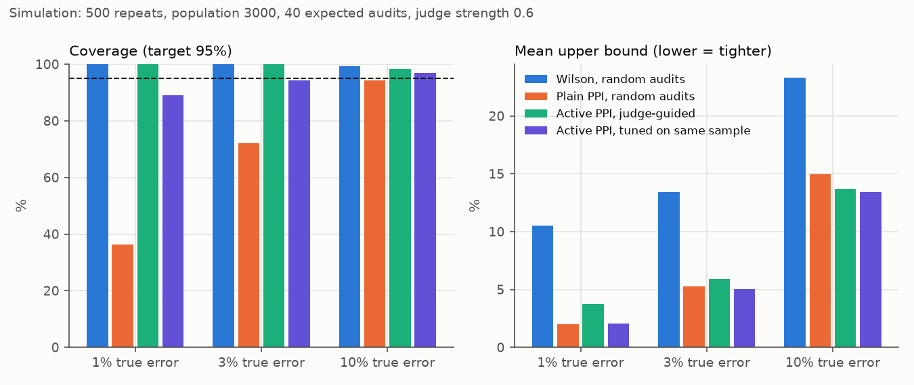

# JudgeGate

**Can an LLM judge replace the human audits that decide when an AI agent may act on its own?**
Tested on 14,851 real purchase-card bookings that council finance staff coded by hand, with free local models (Llama-3.2-3B and Qwen2.5-3B on Apple Silicon, no API).

[](https://github.com/VijayChamakuri/judgegate/actions/workflows/ci.yml)
[](https://vijaychamakuri.github.io/judgegate/)
[](LICENSE)

**[Live dashboard and judge-mistake browser →](https://vijaychamakuri.github.io/judgegate/)** · Companion to [TrustGate](https://github.com/VijayChamakuri/trustgate), which gates an agent's autonomy with human audits.

## In plain English

A finance agent books council card payments to ledger accounts. A *gate* decides how much of that work the agent may do unchecked. It needs evidence, usually human spot-checks, that the agent's error rate is under a budget. Human checks are slow and costly, so the tempting move is to let a cheaper AI "judge" do the checking.

JudgeGate tests that move on 14,851 real bookings, where council staff's own coding is the right answer, with two free local judges. Both can *rank* bookings (wrong ones score as riskier), but both are too strict to believe as-is, so on their own they unlock nothing. The textbook statistical repair (PPI) makes a judge look like a big win: 44% of bookings automated at a 2% error budget instead of 11%. But the safety margin it reports is too small when mistakes are rare, which is exactly when a gate is deciding. A version that is honest about its uncertainty does exist. With the better-calibrated judge it roughly matches human checks; with the worse one it loses to them.

So the deliverable is less a judge than a **test harness**: before any judge-backed number is allowed to grant autonomy, check its coverage on real data where the truth is known, and average over audit draws rather than trusting one lucky run.

## Key results

1. **Judges rank well but can't be taken at their word.** Llama-3.2-3B and Qwen2.5-3B rank wrong bookings above right ones about equally well (AUC 0.84 and 0.84), but at the natural 0.5 cut-off they reject 81% and 32% of *correct* bookings. Qwen is far better calibrated (ECE 0.29 vs 0.61; it agrees with staff on 69.7% of lines vs 27.5%, exact McNemar p < 1e-300). Used as the gate's only evidence, neither judge grants **any autonomy** at any budget.
2. **The obvious statistical fix looks like a free lunch, and isn't.** Plain PPI (judge on every line, recalibrated on earlier months, corrected with 20 random audits a month) let the gate auto-post 43.9% of live upstream lines at a 2% budget, against 11.5% for the same audits and no judge (mean of 20 audit draws). But on real slices where errors are rare (0–10%), its "95%" bound covered the true error rate as little as 14% of the time with 40 audits and 84% with 400, against a promised 95%. Its extra autonomy rests on a safety margin that is too small: on this easy data the agent's confident lines happen to be nearly error-free, so nothing broke, but the bound would not have warned you if they weren't.
3. **An honest judge-assisted bound exists, and its value depends on the judge.** Active PPI (audits drawn where the judge sees risk, inverse-probability weighted) covered the truth at least 96% of the time on every real slice (Wilson: 98%). At a 5% budget with 20 audits a month it auto-posted 67.6% with Qwen, 31.1% with Llama, and 61.4% with humans alone (draw-to-draw sd about 12%). Judge-guided audits flow to risky lines the gate never automates, so only a well-calibrated judge earns them back.
4. **The judge's extra information is real but small.** Added to the agent's own confidence, Llama lifts cross-validated error-detection AUC from 0.942 to 0.949 upstream (Qwen: 0.950) and from 0.759 to 0.790 on card feed (likelihood-ratio test p = 9e-28 upstream, p = 3e-62 card feed). On its own the judge is *worse* than the agent's confidence at triage: the 20% of upstream lines Llama flags hold 62% of the errors, against 84% for the agent's least-confident 20%.
5. **Single runs mislead.** With 20 audits a month, plain PPI's automation rate at a 2% budget has a standard deviation of 24 percentage points between audit draws. Every rollout number here is a mean over 20 draws.

**What I would ship:** human audits stay the evidence for autonomy unless a judge-assisted bound passes a coverage test like section 3 on real, rare-error data, and then only with a well-calibrated judge. The judge, combined with the agent's confidence, orders the human review queue.



## Terms used below

| Term | Meaning |
|---|---|
| Agent | The model that proposes a GL account for each card line (TrustGate's coder, refit every 3 months on earlier months only) |
| Judge | A local LLM that sees the line, the agent's proposal and similar earlier bookings, and gives the probability the proposal is correct. It never sees the staff answer |
| Gate | Each month, auto-posts the agent's lines above a confidence threshold, chosen so that a 95% upper bound on their error rate, from earlier months only, fits the budget |
| Error budget | The highest error rate allowed among auto-posted lines (2%, 5% or 10%) |
| Audit | A human checking one line. Here the staff booking plays the human |
| False pass / false fail | The judge approving a wrong booking / rejecting a correct one |
| AUC | How well the judge's scores rank wrong bookings above right ones: 0.5 = chance, 1 = perfect |
| Calibration (ECE) | Whether "70% likely correct" means right 70% of the time. ECE is the average gap |
| PPI | Prediction-powered inference: estimate from the judge's scores on every line, then correct the judge's bias with the human audits |
| Active PPI | PPI where audits are drawn more often where the judge sees risk, and each audit is up-weighted by 1/(chance it was drawn) so the estimate stays unbiased |
| Coverage | How often a "95% upper bound" really sits above the true error rate. Below 95% means the bound is over-optimistic |
| Months over budget | Live months in which the auto-posted lines' real error rate exceeded the budget |

## 1 · How good are the judges?

| Judge | Setting | Lines | Agent wrong | AUC (95% CI) | Cohen's κ at 0.5 | False pass | False fail | ECE |
|---|---|---:|---:|---|---:|---:|---:|---:|
| Llama-3.2-3B | Card feed | 4,987 | 35.0% | 0.75 (0.74–0.76) | 0.11 | 3.4% | 81.7% | 0.374 |
| Llama-3.2-3B | Upstream | 4,987 | 10.4% | 0.84 (0.82–0.86) | 0.04 | 1.5% | 80.8% | 0.613 |
| Qwen2.5-3B | Upstream | 4,987 | 10.4% | 0.84 (0.83–0.86) | 0.25 | 13.4% | 32.3% | 0.287 |

Llama vs Qwen on the same upstream lines (exact McNemar test on the lines where they disagree at 0.5): Llama right and Qwen wrong on 76 lines, the reverse on 2180, p < 1e-300.



## 2 · Does the judge earn autonomy safely?

3,826 live lines over 20 months. Upstream setting, Llama-3.2-3B judge, 5% error budget. Every policy with humans spends the same expected number of audits, and every row is a mean over 20 independent audit draws.

| Policy | Audits / month | Human labels | Auto-posted (mean ± sd) | Error when auto-posted | Months over budget (mean) | Draws with any month over | Mis-posted £ (mean) |
|---|---:|---:|---:|---:|---:|---:|---:|
| Human audits only (Wilson bound) | 10 | 260 | 29.6% ± 17.6% | 0.68% | 0.0 / 20 | 0% | £1,182 |
| Human audits only (Wilson bound) | 20 | 520 | 61.4% ± 8.7% | 0.63% | 0.0 / 20 | 0% | £2,456 |
| Human audits only (Wilson bound) | 40 | 1,040 | 69.1% ± 6.7% | 0.61% | 0.0 / 20 | 0% | £2,474 |
| Raw judge, no humans | 0 | 0 | 0.0% ± 0.0% | – | 0.0 / 20 | 0% | £0 |
| Judge + random audits (plain PPI) | 10 | 260 | 56.2% ± 20.3% | 0.55% | 0.0 / 20 | 0% | £1,720 |
| Judge + random audits (plain PPI) | 20 | 520 | 74.0% ± 8.3% | 0.61% | 0.0 / 20 | 0% | £2,780 |
| Judge + random audits (plain PPI) | 40 | 1,040 | 74.9% ± 6.6% | 0.61% | 0.0 / 20 | 0% | £2,627 |
| Judge + judge-guided audits (active PPI) | 10 | 259 | 3.4% ± 6.2% | 0.96% | 0.0 / 20 | 0% | £207 |
| Judge + judge-guided audits (active PPI) | 20 | 513 | 31.1% ± 15.5% | 0.99% | 0.0 / 20 | 0% | £1,773 |
| Judge + judge-guided audits (active PPI) | 40 | 1,035 | 56.4% ± 16.8% | 1.08% | 0.0 / 20 | 0% | £3,659 |

Across budgets and judges, with 20 audits a month (cells: share auto-posted / mean months over budget):

| Setting | Judge | Budget | Raw judge: auto / months over | Human only: auto / months over | Active PPI: auto / months over |
|---|---|---:|---|---|---|
| Card feed | Llama-3.2-3B | 2% | 0.0% / 0.0 | 0.0% / 0.0 | 0.0% / 0.0 |
| Card feed | Llama-3.2-3B | 5% | 0.0% / 0.0 | 0.0% / 0.0 | 0.0% / 0.0 |
| Card feed | Llama-3.2-3B | 10% | 0.0% / 0.0 | 1.1% / 0.5 | 0.6% / 0.2 |
| Upstream | Llama-3.2-3B | 2% | 0.0% / 0.0 | 11.5% / 0.1 | 0.0% / 0.0 |
| Upstream | Llama-3.2-3B | 5% | 0.0% / 0.0 | 61.4% / 0.0 | 31.1% / 0.0 |
| Upstream | Llama-3.2-3B | 10% | 0.0% / 0.0 | 86.8% / 0.0 | 73.2% / 0.0 |
| Upstream | Qwen2.5-3B | 2% | 0.0% / 0.0 | 11.5% / 0.1 | 14.6% / 0.2 |
| Upstream | Qwen2.5-3B | 5% | 0.0% / 0.0 | 61.4% / 0.0 | 67.6% / 0.1 |
| Upstream | Qwen2.5-3B | 10% | 0.0% / 0.0 | 86.8% / 0.0 | 90.5% / 0.0 |

## 3 · Are the error bounds honest?

**Simulation** (500 repeats per cell, population 3,000, 40 expected audits; cells: coverage / mean bound):

| Judge strength | True error | Wilson, random audits | Plain PPI, random audits | Active PPI, judge-guided audits | Active PPI, tuned on the same sample |
|---:|---:|---|---|---|---|
| 0.3 | 1% | 100.0% / 10.53% | 36.2% / 2.60% | 100.0% / 3.95% | 76.6% / 2.31% |
| 0.3 | 3% | 100.0% / 13.46% | 72.0% / 6.48% | 99.0% / 6.32% | 88.0% / 5.63% |
| 0.3 | 10% | 99.4% / 23.31% | 94.6% / 17.58% | 96.4% / 15.02% | 95.0% / 14.96% |
| 0.6 | 1% | 100.0% / 10.53% | 36.2% / 1.99% | 100.0% / 3.76% | 89.0% / 2.04% |
| 0.6 | 3% | 100.0% / 13.46% | 72.0% / 5.27% | 100.0% / 5.89% | 94.2% / 5.00% |
| 0.6 | 10% | 99.4% / 23.31% | 94.2% / 14.98% | 98.4% / 13.65% | 97.0% / 13.44% |
| 0.9 | 1% | 100.0% / 10.53% | 36.2% / 1.55% | 100.0% / 3.75% | 88.6% / 1.90% |
| 0.9 | 3% | 100.0% / 13.46% | 72.0% / 4.31% | 100.0% / 5.86% | 97.6% / 4.71% |
| 0.9 | 10% | 99.4% / 23.31% | 94.0% / 12.95% | 99.8% / 13.43% | 97.8% / 12.86% |



**Real data**: live-month Stockport lines, kept from the agent's most confident down, so the true error rate (known for every line) ranges from common to rare. Judge scores are recalibrated once on the shadow months, and only the audits are redrawn, 1,000 times. Shown: slices with a true error between 0% and 10%, the regime a gate decides in. Every slice is on the [site](https://vijaychamakuri.github.io/judgegate/) and in `results/coverage.json`.

| Judge | Setting | Lines kept (agent confidence) | True error | Audits | Wilson, random audits | Plain PPI, random audits | Active PPI, judge-guided audits | Active PPI, tuned on the same sample |
|---|---|---|---:|---:|---|---|---|---|
| Llama-3.2-3B | Card feed | top 10% | 4.18% | 40 | 100.0% / 15.24% | 84.5% / 9.40% | 100.0% / 12.45% | 81.9% / 9.35% |
| Llama-3.2-3B | Upstream | top 100% | 4.18% | 40 | 100.0% / 14.89% | 80.2% / 8.91% | 100.0% / 11.50% | 84.8% / 8.58% |
| Llama-3.2-3B | Upstream | top 100% | 4.18% | 400 | 98.6% / 6.61% | 95.5% / 6.06% | 97.3% / 6.42% | 94.8% / 5.78% |
| Llama-3.2-3B | Upstream | top 90% | 0.87% | 40 | 100.0% / 10.21% | 31.2% / 2.47% | 100.0% / 8.29% | 39.2% / 2.35% |
| Llama-3.2-3B | Upstream | top 90% | 0.87% | 400 | 100.0% / 2.33% | 87.4% / 1.73% | 100.0% / 2.88% | 77.3% / 1.70% |
| Llama-3.2-3B | Upstream | top 80% | 0.42% | 40 | 100.0% / 9.41% | 14.5% / 1.11% | 100.0% / 7.64% | 19.9% / 1.32% |
| Llama-3.2-3B | Upstream | top 80% | 0.42% | 400 | 100.0% / 1.66% | 84.4% / 0.98% | 100.0% / 2.34% | 61.7% / 0.99% |
| Qwen2.5-3B | Upstream | top 100% | 4.18% | 40 | 100.0% / 14.89% | 80.2% / 8.88% | 100.0% / 11.28% | 87.6% / 8.34% |
| Qwen2.5-3B | Upstream | top 100% | 4.18% | 400 | 98.6% / 6.61% | 95.4% / 6.05% | 97.8% / 6.32% | 96.1% / 5.68% |
| Qwen2.5-3B | Upstream | top 90% | 0.87% | 40 | 100.0% / 10.21% | 31.2% / 2.47% | 100.0% / 8.02% | 42.2% / 2.26% |
| Qwen2.5-3B | Upstream | top 90% | 0.87% | 400 | 100.0% / 2.33% | 87.4% / 1.73% | 100.0% / 2.79% | 85.4% / 1.65% |
| Qwen2.5-3B | Upstream | top 80% | 0.42% | 40 | 100.0% / 9.41% | 14.5% / 1.11% | 100.0% / 7.42% | 23.2% / 1.28% |
| Qwen2.5-3B | Upstream | top 80% | 0.42% | 400 | 100.0% / 1.66% | 84.4% / 0.98% | 100.0% / 2.27% | 71.2% / 0.97% |

## 4 · What the judge gets wrong

23% of the agent's upstream errors are lines staff booked to the **COVID 19** account (3.5% of all lines): a pandemic-era account that no merchant, department or precedent predicts, so neither agent nor judge can see it coming. Many other "errors" are near-synonym accounts (Travelling Expenses vs Expenses and Allowances).

Wrong bookings the Llama-3.2-3B judge was most sure were correct (upstream):

| Merchant | Department | £ | Agent proposed | Staff booked | Judge P(correct) |
|---|---|---:|---|---|---:|
| GOOGLE ADS8179771860 | Services to People | 500.00 | Office Expenses | Publicity and Promotion | 0.686 |
| MANCHESTER AIRPORT | Services to People | 46.00 | Travelling Expenses | Expenses and Allowances | 0.602 |
| VILLAGE HOTEL HYDE | Services to People | 593.50 | Travelling Expenses | Expenses and Allowances | 0.554 |
| BRITANNIA HOTEL | Services to People | 60.00 | Travelling Expenses | Expenses and Allowances | 0.549 |
| VILLAGE HOTEL HYDE | Services to People | 73.50 | Travelling Expenses | Expenses and Allowances | 0.543 |
| VILLAGE HOTEL HYDE | Services to People | 391.50 | Travelling Expenses | Expenses and Allowances | 0.514 |

Correct bookings it was most sure were wrong:

| Merchant | Department | £ | Agent proposed | Staff booked | Judge P(correct) |
|---|---|---:|---|---|---:|
| CO-OP GROUP 108689 | Services to People | 12.00 | Catering Supplies | Catering Supplies | 0.012 |
| THE EDGE (SYSTEMS) LIM | Services to People | 12.00 | Furniture and Equipment | Furniture and Equipment | 0.013 |
| STAPLES | Services to People | 62.88 | Furniture and Equipment | Furniture and Equipment | 0.013 |
| ORGANIZATIONS, CHARITABLE AND SOCIAL SERVICES | Services to People | 11.97 | Furniture and Equipment | Furniture and Equipment | 0.014 |
| SQ  MEDIA PRINT AND DE | Services to Place | 392.40 | Office Expenses | Office Expenses | 0.014 |
| PAYPAL  3D 360 LTD | Services to People | 37.99 | Furniture and Equipment | Furniture and Equipment | 0.014 |

Browse every judge's mistakes on the [site](https://vijaychamakuri.github.io/judgegate/). Some "false passes" may be staff labelling inconsistencies rather than judge errors. See the data card.

## How it works

```
Stockport card lines + staff-booked accounts (TrustGate's dbt warehouse)
   ├─ agent: expanding-window coder → proposed account + confidence per line
   ├─ judge: local LLM, one forward pass → P(proposal correct) per line
   └─ gate: monthly threshold from a 95% upper bound on error, earlier months only
         evidence = human audits | raw judge | judge + random audits (PPI) | judge + judge-guided audits (active PPI)
```

Details are in [docs/METHODOLOGY.md](docs/METHODOLOGY.md), the reasoning behind each choice in [docs/DESIGN_DECISIONS.md](docs/DESIGN_DECISIONS.md), and the data in [docs/DATA_CARD.md](docs/DATA_CARD.md).

## Reproduce

```bash
uv sync --all-groups
uv run judgegate reproduce   # every number, chart, the site and this README, from committed model outputs (any OS, minutes)
uv run judgegate generate    # optional: re-run the models (Apple Silicon + MLX, about 4 hours on an 8 GB M2, resumable)
make test                    # ruff, mypy, pytest (includes "README matches results")
```

CI recomputes `results/*.json` from the committed judge verdicts and fails if they differ, or if this README is out of date.

## Repository layout

```
src/judgegate/   agent.py · llm.py (MLX letter scoring) · prompts.py · retrieval.py · generate.py
                 stats.py (Wilson, PPI++, active PPI, calibration) · gate.py (monthly rollout) · simulate.py
                 analyze.py · charts.py · site.py · readme.py · cli.py
data/            stockport_labelled_lines.csv.gz · generations/ (agent proposals, judge verdicts)
results/         judgegate.json · coverage.json · charts
docs/            METHODOLOGY · DESIGN_DECISIONS · DATA_CARD · README.template.md
tests/           bounds and coverage, no-leak guards for retrieval, audits and calibration, README drift
```

## Limitations

- **One organisation, one task.** Stockport's coding culture and 21-account chart are not a company's.
- **Small local judges.** 3B models on a laptop. A frontier judge would probably be better calibrated. The harness, not the judge, is the point: it would tell you whether that judge's numbers can be trusted.
- **Staff labels are not perfect.** Some "false passes" may be inconsistent staff coding. Examples are on the site.
- **The upstream setting is easy by design.** Its procurement category nearly fixes the account, and the agent makes almost no errors on its confident half, so coverage there is trivially 100%. The informative slices are shown above.
- **The gate itself is deliberately simple.** It takes the lowest confidence threshold whose bound fits (a search that favours optimistic bounds) and has no novelty guard, so on card-feed data even human-only gating ran over budget in some months. [TrustGate](https://github.com/VijayChamakuri/trustgate) adds those guards. Here they are left out so that only the evidence differs between policies.
- **Simulation settings are stylised.** Judge noise and error rates are chosen to bracket the real data, not fitted to it. 500 repeats per cell.

## Citation and licence

Code: MIT ([LICENSE](LICENSE)); please cite with [CITATION.cff](CITATION.cff). Data: Stockport Metropolitan Borough Council purchase-card transactions. *Contains public sector information licensed under the Open Government Licence v3.0.*

Methods: Angelopoulos, Bates, Fannjiang, Jordan, Zrnic, "Prediction-powered inference", *Science* 2023 · Angelopoulos, Duchi, Zrnic, "PPI++", arXiv:2311.01453 · Zrnic & Candès, "Active statistical inference", ICML 2024.
