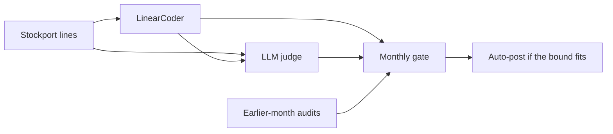

# JudgeGate

[](https://github.com/VijayChamakuri/judgegate/actions/workflows/ci.yml)
[](pyproject.toml)
[](LICENSE)

JudgeGate measures whether a local LLM judge can replace the human audits that decide when a bookkeeping agent may post a general-ledger line on its own. On the 4,987 Stockport card lines from January 2020, out of 14,851 staff-coded lines in the file, plain PPI auto-posts 43.9% of live upstream lines at a 2% budget against 11.5% for the same audits and no judge, and on real slices that 95% bound covers the true error as little as 14.5% of the time.



Upstream, 20 human audits a month, mean ± standard deviation over 20 audit draws. 3,826 live lines, 20 months. The judge-alone row is the same for both models: it auto-posts nothing at 2%, 5%, and 10%.

| Evidence | Auto-posted at 2% | Auto-posted at 5% |
|---|---:|---:|
| Human audits, Wilson | 11.5% ± 15.3% | 61.4% ± 8.7% |
| Judge alone | 0.0% | 0.0% |
| Plain PPI, Llama-3.2-3B | 43.9% ± 24.0% | 74.0% ± 8.3% |
| Active PPI, Llama-3.2-3B | 0.0% ± 0.0% | 31.1% ± 15.5% |
| Active PPI, Qwen2.5-3B | 14.6% ± 11.7% | 67.6% ± 12.5% |

Qwen's plain-PPI auto-post rates, at the same 20 audits a month, differ from Llama's by at most 0.5 percentage points across the 2%, 5%, and 10% budgets. On the lines that plain PPI auto-posted in that 2% rollout, the mean error was 0.30%, and 4 of the 20 draws still had a month over the budget.

Coverage is a separate check from the rollout. Judge scores stay fixed, the audits are redrawn 1,000 times, and the rate is how often the 95% bound sits on or above the true error. Plain PPI's worst cell is Llama-3.2-3B, upstream, the top 80% by agent confidence, true error 0.42%, 40 audits: 14.5% of redraws. The same lines at 400 audits are covered 84.4% of the time. Active PPI and Wilson are at their worst on the same cell, Llama-3.2-3B, card feed, all live lines, true error 33.43%, 40 audits: 96.1% and 98.1%. That cell is a high-error population, not the rare-error slice where plain PPI fails.

The rollout and the coverage check are plotted in [`results/headline.png`](results/headline.png). The judge table, every budget, the simulation grid, and the lines the judge was sure about are in [docs/RESULTS.md](docs/RESULTS.md). A longer write-up, with a browser for those lines, is at [vijaychamakuri.github.io/judgegate](https://vijaychamakuri.github.io/judgegate/). [TrustGate](https://github.com/VijayChamakuri/trustgate) is the human-audit gate these policies are compared against.

## How it works

The agent is TrustGate's coder, not an LLM. Character n-grams of the merchant, one-hot department and service, a local embedding (`BAAI/bge-small-en-v1.5`), and log amount go into logistic regression. The upstream setting also gets the council's procurement category, which in these years was assigned by staff and nearly fixes the account. The coder is refit every three months on months strictly before the month being coded ([`propose`](src/judgegate/agent.py)). Upstream accuracy on the 4,987 scored lines is 89.6%; card feed, which is what a card network actually sends, is 65.0%.

The judge sees the line, the proposed account, and five similar bookings from earlier months. It does not see the staff account. The models are `Llama-3.2-3B-Instruct` and `Qwen2.5-3B-Instruct`, 4-bit, via MLX. Qwen is scored on upstream only. The score is one forward pass: the prompt ends at `Answer:`, and P(correct) is the softmax of the logits on the single tokens `A` and `B` ([`LetterScorer.letter_probs`](src/judgegate/llm.py)). Upstream AUC is 0.840 for Llama (95% bootstrap interval in the results doc) and 0.844 for Qwen. At the 0.5 cut, Llama rejects 80.8% of correct upstream bookings and Qwen rejects 32.3%. ECE on P(wrong) is 0.613 and 0.287. On the upstream lines where the two judges disagree at 0.5, Llama matches staff and Qwen does not on 76 lines, and Qwen matches staff and Llama does not on 2,180 (exact McNemar; the p-value underflows to 0 in float64). Agreement with staff is 69.7% for Qwen and 27.5% for Llama.

Each live month the gate walks a confidence grid from 0.30 up and takes the lowest threshold whose 95% upper bound, fit on earlier months only, is within the budget. Lines at or above it are auto-posted ([`choose_threshold`](src/judgegate/gate.py)). The first six months are shadow. A threshold needs at least 20 audited lines in the earlier months. Four policies share that rule, and the three that use people spend the same expected number of audits. Human audits use a Wilson bound on k random lines a month. The raw judge treats its own hard label as the truth and spends no audits. Plain PPI uses the judge's P(wrong) on every line plus k random audits, with the PPI++ weight λ fit on those audits. Active PPI draws each line with probability proportional to the judge's risk plus a floor of 0.2 times the mean risk, up-weights each audit by 1/π, and keeps λ at 1.

Before month m, both PPI policies replace the raw score with a Platt map fit on audits from months before m. The map is fixed before that month's audits are drawn, so the estimators stay unbiased. If the earlier audits do not yet contain both outcomes, the raw score is kept.

Active PPI's per-line term, for a fixed λ, has mean equal to the true error rate whatever the judge's quality. `f` is P(wrong), `pi` is the audit probability, and `y` is read only on audited lines ([`active_ppi_terms`](src/judgegate/stats.py#L98-L103)):

```python
def active_ppi_terms(y: np.ndarray, f: np.ndarray, audited: np.ndarray, pi: np.ndarray, lam: float) -> np.ndarray:
    """Per-item terms whose mean is unbiased for the error rate, for any fixed lam in [0, 1].
    lam = 0 is plain inverse-probability weighting of the audits; lam = 1 fully trusts the judge
    as a control variate."""
    y = np.where(audited, np.asarray(y, float), 0.0)
    return lam * f + np.where(audited, (y - lam * f) / pi, 0.0)
```

The upper bound is the mean of those terms plus 1.96 standard errors, clipped to [0, 1] ([`active_ppi_upper`](src/judgegate/stats.py)). I keep λ = 1 in the gate. Choosing λ to minimise the variance of the same sample is in the coverage tables as its own column: on small, nearly error-free samples that selection sits under the truth.

The judge is a weak second signal once the agent's own confidence is in the model. Cross-validated AUC for the agent's errors goes from 0.942 to 0.949 with Llama upstream, and to 0.950 with Qwen. On card feed it goes from 0.759 to 0.790. A likelihood-ratio test of the judge's coefficient gives p = 9e-28 upstream and p = 3e-62 on card feed. As a review order the judge loses to the agent: the riskiest 20% of upstream lines by Llama hold 62% of the errors, and the least confident 20% by the agent hold 84%.

The algebra, the no-leakage rules, and the simulation design are in [docs/METHODOLOGY.md](docs/METHODOLOGY.md).

## Design decisions

| Choice | Why | Cost |
|---|---|---|
| Staff booking is the label | 14,851 lines were already coded by finance staff | Their inconsistencies count as errors. Some false passes are two names for one kind of spend |
| Logistic coder as the agent, LLM as the judge | I tried a local 3B model as the agent first. On a 200-line pilot it was right about a third of the time, below this coder, so the LLMs only judge | The question is about reviewing another system |
| Letter probabilities, one forward pass | A continuous score on every line, with no sampled text to parse | The answer letter has to be one token |
| Platt scaling on earlier months only | Raw 3B scores call correct bookings wrong (upstream ECE 0.613 for Llama, 0.287 for Qwen) | Until both outcomes have been audited, the raw score is used |
| λ = 1 for active PPI | Tuning λ on the sample you then bound under-covers when errors are rare | Some variance reduction is left on the table |
| Same threshold rule as TrustGate | A difference in auto-post rate is then a difference in the evidence | No novelty guard, and the search takes the lowest threshold that fits, which rewards a bound that is too small |
| Verdicts committed under `data/generations/` | `analyze` and CI run on Linux, where MLX does not | Re-scoring the judges needs Apple Silicon |

The MLX scorer caps the buffer cache at 256 MB and applies the output head to the last position only; the notes on why are in [docs/DESIGN_DECISIONS.md](docs/DESIGN_DECISIONS.md).

## Testing

Three checks, in order of what they can actually catch.

13 passed:

- [`tests/test_stats.py`](tests/test_stats.py) checks Wilson's interval on a known case (0 errors in 100 trials), that plain PPI stays unbiased when the judge over-calls errors, that the active-PPI estimate stays unbiased when the judge is noise, and that both upper bounds lie in (0, 1]. On a rare-error draw (1% errors, 40 audits, 300 repeats, seed 1) it requires active PPI and Wilson to cover at least 93% of repeats, and plain PPI to cover under 80%.
- [`tests/test_gate.py`](tests/test_gate.py) checks that audit draws are reproducible and one month at a time, that judge-guided audits land on riskier lines while spending about k audits a month, and that changing a month's labels does not move that month's threshold or its calibrated scores.
- [`tests/test_retrieval.py`](tests/test_retrieval.py) checks that neighbours come only from earlier months.
- [`tests/test_readme.py`](tests/test_readme.py) checks that this file and [docs/RESULTS.md](docs/RESULTS.md) match a fresh render of `results/*.json`.

`make test` runs ruff, ruff's format check, mypy on `src/`, and pytest.

The coverage study is the check that can fail a method that the unit tests would still call unbiased. [`simulate.py`](src/judgegate/simulate.py) builds populations of 3,000 with error rates 1%, 3%, and 10% and judge strengths 0.3, 0.6, and 0.9, and repeats each cell 500 times at 40 and 120 audits. On the real lines the staff label is known for every row, so [`analyze.py`](src/judgegate/analyze.py) freezes the Platt map on the six shadow months and redraws only the audits, 1,000 times, at 40 and 400 audits. Plain PPI is the method that misses its nominal 95%. Active PPI and Wilson do not. The grid is in [docs/RESULTS.md](docs/RESULTS.md).

[`.github/workflows/ci.yml`](.github/workflows/ci.yml) runs that lint, the type check, and the tests, then runs `judgegate analyze` and fails if `results/judgegate.json` or `results/coverage.json` differ from the commit.

## Limitations

- One council, 21 accounts, January 2017 through June 2022. The coding habits are Stockport's.
- Staff labels are wrong sometimes. 22.8% of the agent's upstream errors are the COVID 19 account (3.5% of upstream lines), which no merchant, department, or earlier booking identifies. Travelling Expenses against Expenses and Allowances shows up the same way.
- Upstream is the easy setting. The procurement category nearly determines the account, and the agent's confident lines are almost clean, so a bound can look fine there without having been tested. The slices with a true error under 10% are the ones that move the decision, and they are in the results doc.
- The judges are 3B and 4-bit. Qwen is not scored on card feed, which is where the agent is wrong on 35.0% of lines.
- The gate takes the lowest threshold whose bound fits. An under-covering bound gets to post more. There is no novelty guard. At a 10% budget and 40 audits a month, the human-only gate on card feed still averages 2.2 of 20 live months over budget (70% of draws have at least one).
- The simulation brackets the data. It is not a fit to these lines.

## What I'd do next

- Score Qwen2.5-3B on card feed with the same prompt and the same coverage grid. That setting has one judge today.
- Run a larger judge through the same letter-probability prompt and the same coverage check before letting its bound move a threshold.
- Fit λ on earlier months, not on the audits inside the bound. The same-sample version is already the column that falls short of 95%.
- Put TrustGate's novelty guard back and re-measure card feed. I left it out so the four policies would differ only in the evidence.

## Run it

```bash
uv sync --all-groups
make test
uv run judgegate reproduce
```

`make test` is ruff, the format check, mypy, and pytest. `judgegate reproduce` reruns `analyze`, redraws the charts, rebuilds `site/`, and rewrites this file and `docs/RESULTS.md` from the verdicts in `data/generations/`. It does not call a model.

```bash
uv run judgegate generate
```

That rebuilds the agent proposals and the judge files. It needs Apple Silicon and MLX, and it resumes a judge file that already has lines in it. The timing notes for an 8 GB machine are in [docs/METHODOLOGY.md](docs/METHODOLOGY.md) and [docs/DESIGN_DECISIONS.md](docs/DESIGN_DECISIONS.md).

## Layout

- [`src/judgegate/stats.py`](src/judgegate/stats.py) — Wilson, PPI++, active PPI, Platt, ECE
- [`src/judgegate/gate.py`](src/judgegate/gate.py) — monthly threshold and the four policies
- [`src/judgegate/llm.py`](src/judgegate/llm.py) — letter probabilities on MLX
- [`src/judgegate/agent.py`](src/judgegate/agent.py) — expanding-window coder
- [`src/judgegate/prompts.py`](src/judgegate/prompts.py) — what the judge is allowed to see
- [`src/judgegate/retrieval.py`](src/judgegate/retrieval.py) — neighbours from earlier months only
- [`src/judgegate/analyze.py`](src/judgegate/analyze.py) — every number under `results/`
- [`src/judgegate/simulate.py`](src/judgegate/simulate.py) — coverage simulation and the real-data redraws
- [`data/stockport_labelled_lines.csv.gz`](data/stockport_labelled_lines.csv.gz) — the staff-coded lines
- [`data/generations/`](data/generations) — committed agent proposals and judge verdicts
- [`results/judgegate.json`](results/judgegate.json), [`results/coverage.json`](results/coverage.json) — the numbers above
- [`docs/METHODOLOGY.md`](docs/METHODOLOGY.md), [`docs/DESIGN_DECISIONS.md`](docs/DESIGN_DECISIONS.md), [`docs/DATA_CARD.md`](docs/DATA_CARD.md), [`docs/RESULTS.md`](docs/RESULTS.md)

Code is MIT ([LICENSE](LICENSE)). The card lines are Stockport Metropolitan Borough Council public sector information under the Open Government Licence v3.0; the file, the columns, and the model licences are in [docs/DATA_CARD.md](docs/DATA_CARD.md). Cite the code with [CITATION.cff](CITATION.cff).

The bounds follow Angelopoulos, Bates, Fannjiang, Jordan, and Zrnic, "Prediction-powered inference", *Science* 2023; Angelopoulos, Duchi, and Zrnic, "PPI++", arXiv:2311.01453; Zrnic and Candès, "Active statistical inference", ICML 2024.
