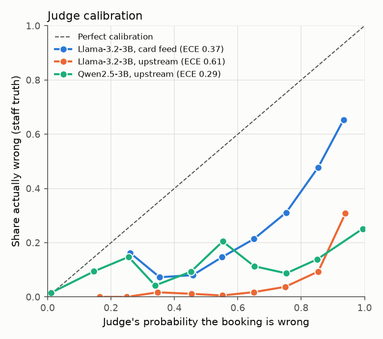
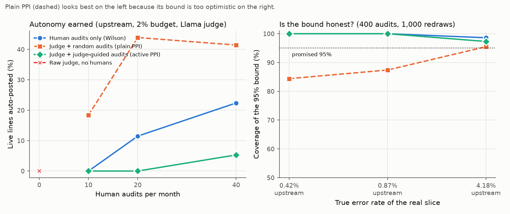
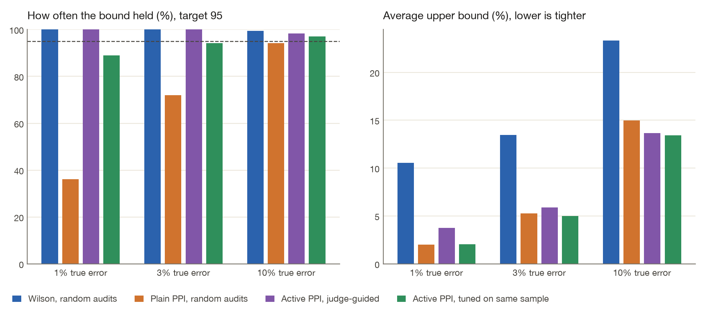

# Results

Rendered from [`results/judgegate.json`](../results/judgegate.json) and [`results/coverage.json`](../results/coverage.json) by `judgegate readme`. [`tests/test_readme.py`](../tests/test_readme.py) fails if this file disagrees with a fresh render. The short version is the [README](../README.md).

Rollout rows are means over 20 independent audit draws, except the raw judge, which does not draw audits. A month is over budget when the lines actually auto-posted that month have a staff-label error rate above the budget.

## Judge quality

| Judge | Setting | Lines | Agent wrong | AUC (95% CI) | Cohen's κ at 0.5 | False pass | False fail | ECE |
|---|---|---:|---:|---|---:|---:|---:|---:|
| Llama-3.2-3B | Card feed | 4,987 | 35.0% | 0.75 (0.74–0.76) | 0.11 | 3.4% | 81.7% | 0.374 |
| Llama-3.2-3B | Upstream | 4,987 | 10.4% | 0.84 (0.82–0.86) | 0.04 | 1.5% | 80.8% | 0.613 |
| Qwen2.5-3B | Upstream | 4,987 | 10.4% | 0.84 (0.83–0.86) | 0.25 | 13.4% | 32.3% | 0.287 |

AUC is a 95% bootstrap interval (500 resamples). Cohen's κ, false pass, and false fail are at a 0.5 cut on P(correct). False pass is the share of wrong bookings the judge approved. False fail is the share of correct bookings it rejected. ECE is expected calibration error over 10 bins, on P(wrong).

Upstream AUC is 0.840 for Llama and 0.844 for Qwen (the table rounds the 95% bootstrap interval). At the 0.5 cut, Llama rejects 80.8% of correct upstream bookings and Qwen rejects 32.3%. ECE on P(wrong) is 0.613 and 0.287.

Llama vs Qwen on the same upstream lines: Llama matches staff and Qwen does not on 76 lines, the reverse on 2,180. The exact McNemar p-value underflows to 0 in float64. Agreement with staff is 27.5% (Llama) and 69.7% (Qwen).

Added to the agent's own confidence, cross-validated AUC for the agent's errors goes from 0.942 to 0.949 with Llama upstream and to 0.950 with Qwen, and from 0.759 to 0.790 on card feed. A likelihood-ratio test of the judge's coefficient gives p = 9e-28 upstream and p = 3e-62 on card feed. The riskiest 20% of upstream lines by Llama hold 62% of the errors; the agent's least-confident 20% hold 84%.

## What the gate auto-posts

Upstream, Llama-3.2-3B, 5% budget, 3,826 live lines over 20 months. Every policy that uses people has the same expected audit count. `–` is a policy that auto-posted nothing, so there is no error rate on auto-posted lines.

| Policy | Audits / month | Human labels | Auto-posted (mean ± sd) | Error when auto-posted | Months over budget (mean) | Draws with any month over | Mis-posted £ (mean) |
|---|---:|---:|---:|---:|---:|---:|---:|
| Human audits only (Wilson bound) | 10 | 260 | 29.6% ± 17.6% | 0.68% | 0.0 / 20 | 0% | £1,182 |
| Human audits only (Wilson bound) | 20 | 520 | 61.4% ± 8.7% | 0.63% | 0.0 / 20 | 0% | £2,456 |
| Human audits only (Wilson bound) | 40 | 1,040 | 69.1% ± 6.7% | 0.61% | 0.0 / 20 | 0% | £2,474 |
| Raw judge, no humans | 0 | 0 | 0.0% ± 0.0% | – | 0.0 / 20 | 0% | £0 |
| Judge + random audits (plain PPI) | 10 | 260 | 56.2% ± 20.3% | 0.55% | 0.0 / 20 | 0% | £1,720 |
| Judge + random audits (plain PPI) | 20 | 520 | 74.0% ± 8.3% | 0.61% | 0.0 / 20 | 0% | £2,780 |
| Judge + random audits (plain PPI) | 40 | 1,040 | 74.9% ± 6.6% | 0.61% | 0.0 / 20 | 0% | £2,627 |
| Judge + judge-guided audits (active PPI) | 10 | 259 | 3.4% ± 6.2% | 0.96% | 0.0 / 20 | 0% | £207 |
| Judge + judge-guided audits (active PPI) | 20 | 513 | 31.1% ± 15.5% | 0.99% | 0.0 / 20 | 0% | £1,773 |
| Judge + judge-guided audits (active PPI) | 40 | 1,035 | 56.4% ± 16.8% | 1.08% | 0.0 / 20 | 0% | £3,659 |

Every setting, judge, and budget at 20 audits a month. Cells are the share auto-posted, then the mean number of live months whose auto-posted lines exceeded the budget.

| Setting | Judge | Budget | Raw judge: auto / months over | Human only: auto / months over | Active PPI: auto / months over |
|---|---|---:|---|---|---|
| Card feed | Llama-3.2-3B | 2% | 0.0% / 0.0 | 0.0% / 0.0 | 0.0% / 0.0 |
| Card feed | Llama-3.2-3B | 5% | 0.0% / 0.0 | 0.0% / 0.0 | 0.0% / 0.0 |
| Card feed | Llama-3.2-3B | 10% | 0.0% / 0.0 | 1.1% / 0.5 | 0.6% / 0.2 |
| Upstream | Llama-3.2-3B | 2% | 0.0% / 0.0 | 11.5% / 0.1 | 0.0% / 0.0 |
| Upstream | Llama-3.2-3B | 5% | 0.0% / 0.0 | 61.4% / 0.0 | 31.1% / 0.0 |
| Upstream | Llama-3.2-3B | 10% | 0.0% / 0.0 | 86.8% / 0.0 | 73.2% / 0.0 |
| Upstream | Qwen2.5-3B | 2% | 0.0% / 0.0 | 11.5% / 0.1 | 14.6% / 0.2 |
| Upstream | Qwen2.5-3B | 5% | 0.0% / 0.0 | 61.4% / 0.0 | 67.6% / 0.1 |
| Upstream | Qwen2.5-3B | 10% | 0.0% / 0.0 | 86.8% / 0.0 | 90.5% / 0.0 |

## Does the 95% bound cover?

Simulation: 500 repeats, population 3,000, 40 expected audits. Cells are coverage, then the mean upper bound. The target coverage is 95%.

| Judge strength | True error | Wilson, random audits | Plain PPI, random audits | Active PPI, judge-guided audits | Active PPI, tuned on the same sample |
|---:|---:|---|---|---|---|
| 0.3 | 1% | 100.0% / 10.53% | 36.2% / 2.60% | 100.0% / 3.95% | 76.6% / 2.31% |
| 0.3 | 3% | 100.0% / 13.46% | 72.0% / 6.48% | 99.0% / 6.32% | 88.0% / 5.63% |
| 0.3 | 10% | 99.4% / 23.31% | 94.6% / 17.58% | 96.4% / 15.02% | 95.0% / 14.96% |
| 0.6 | 1% | 100.0% / 10.53% | 36.2% / 1.99% | 100.0% / 3.76% | 89.0% / 2.04% |
| 0.6 | 3% | 100.0% / 13.46% | 72.0% / 5.27% | 100.0% / 5.89% | 94.2% / 5.00% |
| 0.6 | 10% | 99.4% / 23.31% | 94.2% / 14.98% | 98.4% / 13.65% | 97.0% / 13.44% |
| 0.9 | 1% | 100.0% / 10.53% | 36.2% / 1.55% | 100.0% / 3.75% | 88.6% / 1.90% |
| 0.9 | 3% | 100.0% / 13.46% | 72.0% / 4.31% | 100.0% / 5.86% | 97.6% / 4.71% |
| 0.9 | 10% | 99.4% / 23.31% | 94.0% / 12.95% | 99.8% / 13.43% | 97.8% / 12.86% |

Real Stockport lines. The staff label is known on every line. Judge scores are recalibrated once on the six shadow months, and only the audits are redrawn, 1,000 times. The table keeps slices whose true error is between 0 and 10%, which is the range a gate is deciding in. Every slice, including the high-error ones, is in `results/coverage.json`.

| Judge | Setting | Lines kept (agent confidence) | True error | Audits | Wilson, random audits | Plain PPI, random audits | Active PPI, judge-guided audits | Active PPI, tuned on the same sample |
|---|---|---|---:|---:|---|---|---|---|
| Llama-3.2-3B | Card feed | top 10% | 4.18% | 40 | 100.0% / 15.24% | 84.5% / 9.40% | 100.0% / 12.45% | 81.9% / 9.35% |
| Llama-3.2-3B | Upstream | top 100% | 4.18% | 40 | 100.0% / 14.89% | 80.2% / 8.91% | 100.0% / 11.50% | 84.8% / 8.58% |
| Llama-3.2-3B | Upstream | top 100% | 4.18% | 400 | 98.6% / 6.61% | 95.5% / 6.06% | 97.3% / 6.42% | 94.8% / 5.78% |
| Llama-3.2-3B | Upstream | top 90% | 0.87% | 40 | 100.0% / 10.21% | 31.2% / 2.47% | 100.0% / 8.29% | 39.2% / 2.35% |
| Llama-3.2-3B | Upstream | top 90% | 0.87% | 400 | 100.0% / 2.33% | 87.4% / 1.73% | 100.0% / 2.88% | 77.3% / 1.70% |
| Llama-3.2-3B | Upstream | top 80% | 0.42% | 40 | 100.0% / 9.41% | 14.5% / 1.11% | 100.0% / 7.64% | 19.9% / 1.32% |
| Llama-3.2-3B | Upstream | top 80% | 0.42% | 400 | 100.0% / 1.66% | 84.4% / 0.98% | 100.0% / 2.34% | 61.7% / 0.99% |
| Qwen2.5-3B | Upstream | top 100% | 4.18% | 40 | 100.0% / 14.89% | 80.2% / 8.88% | 100.0% / 11.28% | 87.6% / 8.34% |
| Qwen2.5-3B | Upstream | top 100% | 4.18% | 400 | 98.6% / 6.61% | 95.4% / 6.05% | 97.8% / 6.32% | 96.1% / 5.68% |
| Qwen2.5-3B | Upstream | top 90% | 0.87% | 40 | 100.0% / 10.21% | 31.2% / 2.47% | 100.0% / 8.02% | 42.2% / 2.26% |
| Qwen2.5-3B | Upstream | top 90% | 0.87% | 400 | 100.0% / 2.33% | 87.4% / 1.73% | 100.0% / 2.79% | 85.4% / 1.65% |
| Qwen2.5-3B | Upstream | top 80% | 0.42% | 40 | 100.0% / 9.41% | 14.5% / 1.11% | 100.0% / 7.42% | 23.2% / 1.28% |
| Qwen2.5-3B | Upstream | top 80% | 0.42% | 400 | 100.0% / 1.66% | 84.4% / 0.98% | 100.0% / 2.27% | 71.2% / 0.97% |

## Lines the Llama judge was sure about

22.8% of the agent's upstream errors are lines staff booked to COVID 19 (3.5% of upstream lines). Many of the remaining disagreements are near-synonym accounts.

Wrong upstream bookings Llama-3.2-3B was most sure were correct:

| Merchant | Department | £ | Agent proposed | Staff booked | Judge P(correct) |
|---|---|---:|---|---|---:|
| GOOGLE ADS8179771860 | Services to People | 500.00 | Office Expenses | Publicity and Promotion | 0.686 |
| MANCHESTER AIRPORT | Services to People | 46.00 | Travelling Expenses | Expenses and Allowances | 0.602 |
| VILLAGE HOTEL HYDE | Services to People | 593.50 | Travelling Expenses | Expenses and Allowances | 0.554 |
| BRITANNIA HOTEL | Services to People | 60.00 | Travelling Expenses | Expenses and Allowances | 0.549 |
| VILLAGE HOTEL HYDE | Services to People | 73.50 | Travelling Expenses | Expenses and Allowances | 0.543 |
| VILLAGE HOTEL HYDE | Services to People | 391.50 | Travelling Expenses | Expenses and Allowances | 0.514 |

Correct upstream bookings it was most sure were wrong:

| Merchant | Department | £ | Agent proposed | Staff booked | Judge P(correct) |
|---|---|---:|---|---|---:|
| CO-OP GROUP 108689 | Services to People | 12.00 | Catering Supplies | Catering Supplies | 0.012 |
| THE EDGE (SYSTEMS) LIM | Services to People | 12.00 | Furniture and Equipment | Furniture and Equipment | 0.013 |
| STAPLES | Services to People | 62.88 | Furniture and Equipment | Furniture and Equipment | 0.013 |
| ORGANIZATIONS, CHARITABLE AND SOCIAL SERVICES | Services to People | 11.97 | Furniture and Equipment | Furniture and Equipment | 0.014 |
| SQ  MEDIA PRINT AND DE | Services to Place | 392.40 | Office Expenses | Office Expenses | 0.014 |
| PAYPAL  3D 360 LTD | Services to People | 37.99 | Furniture and Equipment | Furniture and Equipment | 0.014 |

The other judges are on the [site](https://vijaychamakuri.github.io/judgegate/).
